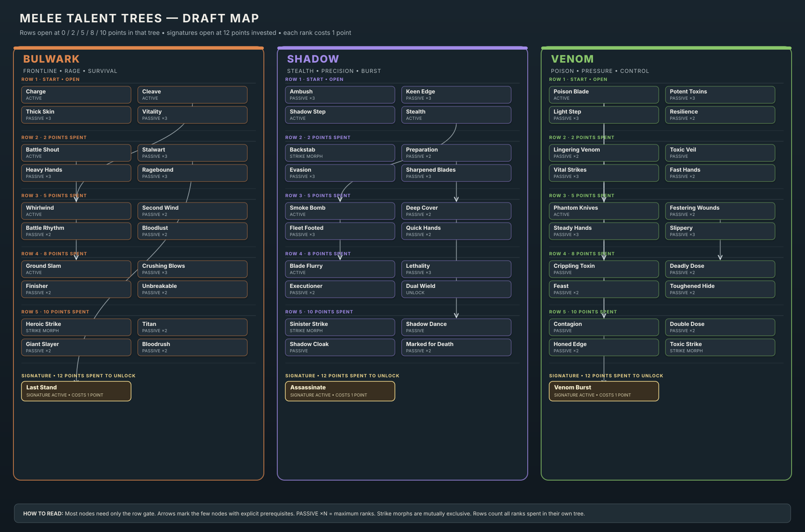
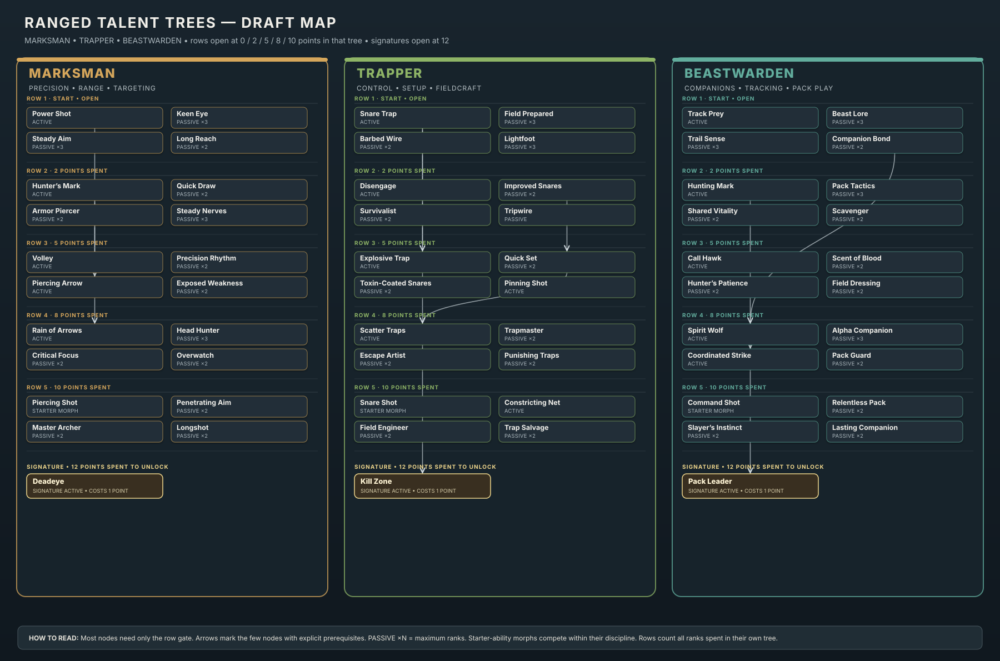
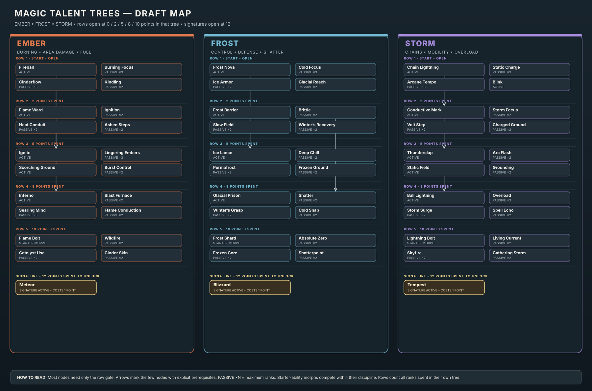

# Skill Ecosystem and Classless Talents

**Status:** working design proposal; no gameplay code has been changed. Confirmed: talents replace class selection; the held weapon activates its discipline's talents; competing morphs for the same starter ability are mutually exclusive; each weapon discipline has its own action bar; every skill caps at level 45; talents can only be learned, changed, or refunded in safe zones (towns, shrines, and camps); weapon swaps are allowed in combat with a short lockout; signatures require 12 points in one tree; rare boss weapons have a moderate broad passive plus a major talent-path synergy. The current game still caps skills at 30.

**Visual atlas:** [TALENT_TREES_ARTIFACT.html](TALENT_TREES_ARTIFACT.html) shows the three Melee, three Ranged, and three Magic draft trees together.

**Implementation notes (current build):** the Warrior is already classless in practice (kit id `warrior`, talents-based abilities, one shared Energy bar that starts full and regenerates about 16 per second; Rage is not built). Backstab replaces Strike through the Strike-morph system alongside Heroic and Sinister. Ranged and Magic have not been moved to the talent model yet.

## What the game does today

- The player selects Warrior, Mage, or Hunter. That choice sets the primary combat skill, base stats, resource, abilities, and the bias for generated gear. Rogue remains in some data and save paths, but it is not in the current class selection list.
- Melee, Magic, and Ranged are separate skills, but only the selected class's skill becomes the character's level. Combat XP goes to that one skill.
- There are 13 skills: Melee, Magic, Ranged, Slayer, Mining, Woodcutting, Fishing, Herblore, Smithing, Crafting, Cooking, Firemaking, and Agility. Their shared level cap is 30.
- Talent points arrive every two character levels. The current trees are stored under Warrior: Bulwark, Shadow, and Venom. Mage and Hunter do not have talent trees yet. Talents teach abilities and grant passive bonuses; tier access requires points spent in that tree.
- A useful crafting loop already exists: twigs make starter tools; Mining and Woodcutting provide inputs for upgraded tools; Smithing turns ore into bars and gear; combat creatures provide bait and potion ingredients; Fishing feeds Cooking; herbs, creature ingredients, and glass vials feed Herblore; Firemaking turns logs into cooking fires.
- Gear can already be equipped by anyone, but generation, stats, recipes, and armor presentation still expect a class.

## Design goals

1. **Talents define the build.** There is no permanent class choice or class-locked kit. Players invest in Melee, Ranged, and Magic talent paths to create a recognizable role or a hybrid.
2. **Every skill has a reason to matter.** Gathering feeds making; making improves gathering, travel, or combat; combat creates materials and goals for the makers.
3. **No profession is a mandatory tax.** A player can buy, find, earn from quests, or trade for key inputs in a future economy. A build should still function if its owner never levels a particular craft.
4. **Every skill has a full 1–45 journey.** Each profession needs added materials, recipes, activities, and mastery rewards; a higher cap alone is not enough.
5. **The level 45 journey has several viable loops.** Combat, exploration, profession work, Slayer contracts, dungeons, and bosses should each contribute useful progress.
6. **Skills and talents provide different kinds of progress.** Skills improve practiced activities; talents choose the character's combat identity.

## Classless combat proposal

### Character level and combat disciplines

Keep the three combat skills—Melee, Ranged, and Magic—but let the player use and level all of them. Define **Character Level as the highest of those three skill levels**. This reuses the existing combat XP and level curve instead of adding a second character XP bar. If a player's Melee is 20 and Magic is 8, they remain level 20 while they train Magic.

For level-up stats, replace class-specific growth with a shared baseline. Gear and talents provide the specialization. Weapon family can still guide the kind of gear that drops, but should not lock what the player can equip. Keep separate ability bars for Melee, Ranged, and Magic so each weapon loadout has the right actions ready.

At the level 45 target, one talent point every two levels gives 22 points per combat discipline. Each discipline has three trees, and point distribution alone defines the build; there is no separate specialization choice. All three trees are visible from the start, but only their first row is initially available. Spending points in one tree unlocks that tree's deeper rows; points in another tree do not count toward it. A player can mix points across those trees to shape a hybrid within that fighting style. For example, a Melee hybrid might combine Bulwark defense, Shadow openers, and Venom pressure. **The held weapon activates its discipline:** a melee weapon activates Melee talents and abilities; a bow activates Ranged; a staff activates Magic. Talents from the other disciplines remain invested but inactive until that weapon is equipped. Each style has an auto-attack and a starting ability; talents can reshape that starting ability, while talents unlock the rest of the active abilities. Each weapon discipline has its own saved action bar; equipping a different style switches the bar, and abilities from the other styles cannot be used. Combat weapon swaps are allowed with a short lockout. If two talent nodes offer competing morphs for the same starting ability, choosing one grays out the other morph choice. Passive talents from all three trees can still be mixed; respec in a safe zone to change the selected morph. Talent points can only be spent or refunded in towns, shrines, and camps, giving those safe places a role in preparing for an expedition.

**Talent point rule (confirmed):** each combat discipline earns its own points from its own level: `floor(discipline_level / 2)`. For example, Melee 10 gives 5 Melee points; Ranged 20 gives 10 Ranged points. At level 45, each discipline can have up to 22 points. Only the held weapon's discipline is active, so players can develop separate weapon builds over time without making all three compete for one small pool.

**Signature talent gate (confirmed):** require at least 12 points already spent in a tree before its signature ability is available. The signature talent itself costs one additional point, so reaching and learning it takes 13 points total. With 22 total points at level 45, a player can learn a signature in only one tree per discipline and has 9 points left to hybridize elsewhere.

**Talent row gates (confirmed):** keep all three trees visible from the start, with only their first row initially available. Unlock deeper rows at 2, 5, 8, and 10 points spent in that specific tree; the signature ability becomes available at 12. Count every point spent in the tree, including each rank of a multi-rank talent. Points spent in other trees do not count toward these gates. This creates room for early mixing while preserving a clear investment path toward one signature.

**Talent node costs and ranks (confirmed):** every talent rank costs one point. Passive talents may have multiple ranks, but each node must clearly display its maximum rank and the effect at each rank; rank counts are set talent by talent when the trees are authored, with multi-rank investment expected mainly on passives. Active ability unlocks and starter-ability morph choices are one-point talents unless a specific design calls out otherwise. A respec refunds only the selected discipline's points; Melee, Ranged, and Magic are respeced independently, in safe zones.

**Talent ability persistence and action bars (confirmed):** each discipline has an action bar with six player-placed ability slots, including its starting ability. This may be revisited if the level 45 trees grant more abilities than six slots can reasonably support. An ability unlocked through a talent is available only while the character has that talent selected; respecing out of its unlock removes access to it. Newly available abilities receive a persistent NEW highlight in their discipline's Abilities panel until viewed.

**Melee resource model (working direction):** use one shared Melee bar, with Energy as the default state and Rage as a temporary combat state; do not ask the player to choose a resource system and do not show two independent pools. Dealing or taking damage shifts the bar from Energy toward Rage, with Rage gained scaling with damage dealt or taken. For the same damage amount, incoming damage should generate about 1.5 times as much Rage as outgoing damage as an initial tuning target. Incoming damage is measured before armor, blocking, and other reductions. Outgoing damage is measured after the target's armor and other reductions, using the damage that actually gets through. All Melee damage dealt—including damage from Rage abilities—can generate Rage; the same base conversion rate applies per damage point for auto attacks and abilities unless a talent modifies it. Rage abilities spend Rage and convert the full cost one-for-one back into Energy, shifting the bar toward Energy rather than leaving that portion empty. Energy abilities, such as Shadow and Venom abilities, spend Energy; Energy slowly regenerates passively throughout combat, even while the player is attacking. Talents may modify Rage generation, Energy costs, and Energy regeneration, with exact effects defined per talent. Rage fades back toward Energy only after the player leaves combat, returning fully to Energy over about 10 seconds. Switching to a Ranged or Magic weapon during combat also starts the Melee bar fading toward Energy; switching back to Melee before the fade completes stops the fade, and Melee damage dealt or taken can build Rage again from the remaining balance. Resource behavior for Ranged and Magic remains undecided.

### Newly unlocked abilities

When a talent unlocks an active ability, give it a brief reveal animation and highlight it in the matching discipline's Abilities panel. Keep a **NEW** marker or similar highlight until the player views the ability, and let the player assign it to that discipline's action bar. Prefer a small, skippable panel-open reveal for the first unlock, with a persistent panel badge for any abilities the player chooses not to inspect yet; avoid repeatedly interrupting talent choices if several abilities unlock together.

### Opening equipment recommendation

Use a **guided open start**, not a class-selection screen. Teach basic combat with a simple sword, then make a basic bow and staff available at Wanderer's Rest before the player earns or spends their first talent point. Give the player a low-risk chance to try each weapon and keep all three accessible. The sword gives the tutorial a clear first lesson; the early weapon rack makes it clear that the player is choosing equipment and a fighting style, not a permanent class. If the player ignores the other weapons, the story should not force them to switch.

### Talent path families

These names are placeholders that keep the existing class fantasy while moving it into the talent system. Mixing points among the three trees within a discipline is intended; only the currently held weapon's discipline is active. Not every path needs to ship at once.

| Discipline | Example talent paths | Build identity |
|---|---|---|
| **Melee** | Bulwark, Shadowblade, Venomcraft | Durable frontliner; stealth and precision; poison and attrition |
| **Ranged** | Marksman, Trapper, Beastwarden | Focused ranged damage; snares and field control; companion and tracking play |
| **Magic** | Ember, Frost, Storm | Area damage and burning; control and protection; chains and mobility |

### Draft Melee tree layouts

The three existing Warrior trees are the first set to lay out. This draft reuses most of the current prototype talents, moves them into the confirmed 0 / 2 / 5 / 8 / 10 point row gates, and adds only a few nodes where the level 45 design needs a clearer resource identity. These are placement and dependency proposals, not final balance values.

**Tree reading rules:** all nodes in an unlocked row are available unless a prerequisite arrow is drawn. A prerequisite adds a specific dependency; it does not replace the row gate. Every rank costs one point, and each passive's maximum rank is shown. Rows count all points invested in that tree, including extra ranks in one node. At 12 points spent, a tree's signature becomes available and costs one additional point to learn; that means a fully learned signature uses 13 points, leaving 9 of the level 45 discipline's 22 points for hybrid investment elsewhere. Strike morphs are one-point choices and mutually exclusive across the Melee trees.

| Tree / gate | Draft nodes and ranks | Explicit dependencies / identity |
|---|---|---|
| **Bulwark — open** | Charge (active); Cleave (active); Thick Skin (3); Vitality (3) | Independent first choices establish initiation, area damage, armor, or health. |
| **Bulwark — 2** | Battle Shout (active); Stalwart (3); Heavy Hands (3); Ragebound (3) | Ragebound increases Rage generated from damage taken, expressing the Bulwark resource identity. |
| **Bulwark — 5** | Whirlwind (active); Second Wind (2); Battle Rhythm (2); Bloodlust (2) | Whirlwind requires Cleave. Other nodes remain open within the row. |
| **Bulwark — 8** | Ground Slam (active); Crushing Blows (3); Finisher (2); Unbreakable (2) | Ground Slam requires Battle Shout; the other nodes have no node prerequisite. |
| **Bulwark — 10** | Heroic Strike (Strike morph); Titan (2); Giant Slayer (2); Bloodrush (2) | Heroic Strike is mutually exclusive with the Shadow and Venom Strike morphs. |
| **Bulwark — signature at 12** | Last Stand (signature active) | Requires Stalwart. A defensive climax for the damage-taking / Rage build. |
| **Shadow — open** | Ambush (3); Keen Edge (3); Shadow Step (active); Stealth (active) | Players can start with stealth, mobility, critical chance, or a stronger opener. |
| **Shadow — 2** | Backstab (Strike morph); Preparation (2); Evasion (3); Sharpened Blades (3) | Backstab competes with the other Strike morphs; all four nodes have no node prerequisite. |
| **Shadow — 5** | Smoke Bomb (active); Deep Cover (2); Fleet Footed (3); Quick Hands (2) | Smoke Bomb requires Stealth; Deep Cover requires Preparation. |
| **Shadow — 8** | Blade Flurry (active); Lethality (3); Executioner (2); Dual Wield (unlock) | Blade Flurry requires Smoke Bomb. Other nodes remain open within the row. |
| **Shadow — 10** | Sinister Strike (Strike morph); Shadow Dance (passive); Shadow Cloak (passive); Marked for Death (2) | Shadow Dance requires Deep Cover. Sinister Strike competes with Backstab and the other Strike morphs. |
| **Shadow — signature at 12** | Assassinate (signature active) | A high-commitment single-target finisher. |
| **Venom — open** | Poison Blade (active); Potent Toxins (3); Light Step (3); Resilience (2) | Starts the poison loop or invests in general mobility and survival. |
| **Venom — 2** | Lingering Venom (2); Toxic Veil (passive); Vital Strikes (3); Fast Hands (2) | These support poison duration, stealth-poison interaction, criticals, or attack tempo. |
| **Venom — 5** | Phantom Knives (active); Festering Wounds (2); Steady Hands (3); Slippery (3) | Phantom Knives requires Poison Blade. Steady Hands improves Energy regeneration. |
| **Venom — 8** | Crippling Toxin (passive); Deadly Dose (2); Feast (2); Toughened Hide (2) | Crippling Toxin requires Lingering Venom; Deadly Dose requires Festering Wounds. |
| **Venom — 10** | Contagion (passive); Double Dose (2); Honed Edge (2); Toxic Strike (Strike morph) | Contagion and Double Dose require Poison Blade. Toxic Strike competes with the other Strike morphs. |
| **Venom — signature at 12** | Venom Burst (signature active) | Requires Poison Blade; detonates the poison investment built across the tree. |

**Prerequisite philosophy:** gates provide broad freedom to hybridize within a tree; arrows are reserved for abilities or combinations that need an earlier mechanic to function (Stealth into Smoke Bomb, Preparation into Deep Cover, Poison Blade into poison-spreading tools, Cleave into Whirlwind, and Battle Shout into Ground Slam). The remaining passives and abilities can be picked in any order once their row is open. This keeps the trees readable without making every node a narrow chain.

**Existing-data cleanup to revisit during implementation:** the prototype still describes Bulwark as restoring Energy when hit, while the new resource design makes Bulwark the Rage path. `Ragebound` should replace or repurpose that outdated effect. The current Shadow tree includes both Backstab and Sinister Strike morph candidates, which need a shared exclusive Strike-morph group. The draft also moves Last Stand to the signature slot and treats Venom Burst as Venom's signature.

### Draft Ranged tree layouts

These are new classless Ranged trees based on the current Hunter kit, expanded around the agreed level 45 row gates. They assume a shared Ranged starter shot exists outside the trees; the Row 5 talents change that starter shot, and those three morphs compete with each other. The current Focus resource has not yet been confirmed as the classless Ranged resource, so no node depends on that decision.

| Tree / gate | Draft nodes and ranks | Explicit dependencies / identity |
|---|---|---|
| **Marksman — open** | Power Shot (active); Keen Eye (3); Steady Aim (3); Long Reach (2) | Direct ranged damage, accuracy, and distance. |
| **Marksman — 2** | Hunter's Mark (active); Quick Draw (2); Armor Piercer (2); Steady Nerves (3) | No node prerequisites. |
| **Marksman — 5** | Volley (active); Precision Rhythm (2); Piercing Arrow (active); Exposed Weakness (2) | Piercing Arrow requires Power Shot. |
| **Marksman — 8** | Rain of Arrows (active); Head Hunter (3); Critical Focus (2); Overwatch (2) | Rain of Arrows requires Hunter's Mark. |
| **Marksman — 10** | Piercing Shot (starter morph); Penetrating Aim (2); Master Archer (2); Longshot (2) | Piercing Shot competes with the other Ranged starter morphs. |
| **Marksman — signature at 12** | Deadeye (signature active) | Precision finisher built around a marked target. |
| **Trapper — open** | Snare Trap (active); Field Prepared (3); Barbed Wire (2); Lightfoot (3) | Opens with area control, trap preparation, bleed pressure, or mobility. |
| **Trapper — 2** | Disengage (active); Improved Snares (2); Survivalist (2); Tripwire (passive) | No node prerequisites. |
| **Trapper — 5** | Explosive Trap (active); Quick Set (2); Toxin-Coated Snares (2); Pinning Shot (active) | Explosive Trap requires Snare Trap. Toxin coating can benefit from Herblore without requiring it. |
| **Trapper — 8** | Scatter Traps (active); Trapmaster (2); Escape Artist (2); Punishing Traps (2) | Quick Set is required for Scatter Traps. |
| **Trapper — 10** | Snare Shot (starter morph); Constricting Net (active); Field Engineer (2); Trap Salvage (2) | Snare Shot competes with other Ranged starter morphs. |
| **Trapper — signature at 12** | Kill Zone (signature active) | Requires Snare Trap; turns the area around the player into a layered trap field. |
| **Beastwarden — open** | Track Prey (active); Beast Lore (3); Trail Sense (3); Companion Bond (2) | Tracking and companion foundation; no pet is required to take the broad passives. |
| **Beastwarden — 2** | Hunting Mark (active); Pack Tactics (3); Shared Vitality (2); Scavenger (2) | No node prerequisites. |
| **Beastwarden — 5** | Call Hawk (active); Scent of Blood (2); Hunter's Patience (2); Field Dressing (2) | No node prerequisites; utility and sustain branch. |
| **Beastwarden — 8** | Spirit Wolf (active); Alpha Companion (3); Coordinated Strike (active); Pack Guard (2) | Spirit Wolf requires Companion Bond; Coordinated Strike requires Hunting Mark. |
| **Beastwarden — 10** | Command Shot (starter morph); Relentless Pack (2); Slayer's Instinct (2); Lasting Companion (2) | Command Shot competes with other Ranged starter morphs. |
| **Beastwarden — signature at 12** | Pack Leader (signature active) | Requires Spirit Wolf; upgrades the companion into a major part of the build. |

### Draft Magic tree layouts

The three elemental trees reuse the current Mage abilities where possible and add nodes to fill the same level 45 progression. These drafts assume a common Magic starter spell outside the trees; each Row 5 elemental morph changes that spell. Mana is the current Mage resource, but the classless Magic resource model still needs a decision, so these layouts avoid locking in resource rules.

| Tree / gate | Draft nodes and ranks | Explicit dependencies / identity |
|---|---|---|
| **Ember — open** | Fireball (active); Burning Focus (3); Cinderflow (3); Kindling (2) | Area damage and burning; Fireball reuses the current Mage ability. |
| **Ember — 2** | Flame Ward (active); Ignition (2); Heat Conduit (2); Ashen Steps (2) | No node prerequisites. |
| **Ember — 5** | Ignite (active); Lingering Embers (3); Scorching Ground (active); Burst Control (2) | Ignite requires Fireball. |
| **Ember — 8** | Inferno (active); Blast Furnace (2); Searing Mind (3); Flame Conduction (2) | Inferno requires Heat Conduit. |
| **Ember — 10** | Flame Bolt (starter morph); Wildfire (2); Catalyst Use (2); Cinder Skin (2) | Flame Bolt competes with Frost Shard and Lightning Bolt. Catalyst Use can improve crafted reagents without requiring Crafting. |
| **Ember — signature at 12** | Meteor (signature active) | Reuses the current Meteor ability as Ember's high-commitment area finisher. |
| **Frost — open** | Frost Nova (active); Cold Focus (3); Ice Armor (2); Glacial Reach (2) | Control and protection are available from the first row. |
| **Frost — 2** | Frost Barrier (active); Brittle (2); Slow Field (2); Winter's Recovery (2) | No node prerequisites. |
| **Frost — 5** | Ice Lance (active); Deep Chill (2); Permafrost (3); Frozen Ground (2) | Ice Lance requires Frost Nova. |
| **Frost — 8** | Glacial Prison (active); Shatter (2); Winter's Grasp (2); Cold Snap (2) | Shatter requires Brittle. |
| **Frost — 10** | Frost Shard (starter morph); Absolute Zero (2); Frozen Core (2); Shatterpoint (2) | Frost Shard competes with the other elemental starter morphs. |
| **Frost — signature at 12** | Blizzard (signature active) | A large-area control and damage spell. |
| **Storm — open** | Chain Lightning (active); Static Charge (3); Arcane Tempo (3); Blink (active) | Chains and mobility; both abilities reuse the current Mage kit. |
| **Storm — 2** | Conductive Mark (active); Storm Focus (2); Volt Step (2); Charged Ground (2) | Conductive Mark requires Chain Lightning. |
| **Storm — 5** | Thunderclap (active); Arc Flash (2); Static Field (active); Grounding (2) | Thunderclap requires Conductive Mark. |
| **Storm — 8** | Ball Lightning (active); Overload (3); Storm Surge (2); Spell Echo (2) | Ball Lightning requires Static Field. |
| **Storm — 10** | Lightning Bolt (starter morph); Living Current (2); Skyfire (2); Gathering Storm (2) | Lightning Bolt competes with the other elemental starter morphs. |
| **Storm — signature at 12** | Tempest (signature active) | A sustained storm field that rewards chaining attacks across multiple targets. |

**Prerequisite philosophy for both disciplines:** the point gates unlock rows, while arrows show only a few mechanical dependencies. Every other node is open within its row, which lets a player mix damage, control, utility, and passive bonuses without having to follow a single ladder. The Ranged starter morphs are mutually exclusive with one another, as are the Magic starter morphs. The Trapper tree creates an optional Crafting/Herblore link, and Beastwarden supports Slayer and field-preparation play, but none of those professions should be mandatory to use the combat talents.

Talent paths can cross-link without requiring a class. Examples: Venomcraft improves crafted coatings; Trapper uses monster parts and crafted snares; Bulwark improves forged armor or guard tools; Ember consumes crafted fuel or mineral catalysts. These links should provide optional build flavor, not force a character to grind a profession before using their combat talents.

### Rare weapon passives

Rare weapons can carry passive traits, but should not grant new active abilities. The confirmed direction is for boss weapons to have both a moderate broad passive and a much stronger talent-path synergy. For example, a bow might give a small general ranged benefit plus a substantial enhancement for Trapper talents; a staff might give a modest spell bonus plus a large Storm-path interaction. These should come from predetermined bosses, with the boss and weapon chosen to fit the build fantasy. Keep the trait visible in the item tooltip, make it work only with its weapon discipline, and avoid making a rare drop required for a talent build to function.

## Connected skill network

| Skill | Main inputs or activity | What it feeds | What feeds it back |
|---|---|---|---|
| **Mining** | Ore, stone, and rare crystals | Smithing, Crafting, upgrade materials | Better picks from Crafting/Smithing; access from Agility routes and quests |
| **Woodcutting** | Logs, hardwood, rare resins | Tools, bows/staves, rods, kindling, camp supplies | Better axes from Crafting/Smithing; rare stands reached by exploration |
| **Herblore** | Plants plus creature/biome reagents | Healing, buffs, weapon coatings, control consumables | Monster parts from combat/Slayer; vials and mixing tools from Crafting/Smithing |
| **Fishing** | Bait, rod, fish | Cooking, oils, lures, quest ingredients | Bait from creatures; rods from Crafting; better fishing spots via Agility/exploration |
| **Cooking** | Fish, meat, herbs, fuel | Healing meals, short preparation buffs, bait/stock for quests | Fish from Fishing; meat and spices from combat, gathering, or vendors; fires from Firemaking |
| **Smithing** | Mined ore, bars, charcoal/fuel | Weapons, armor, tools, repairs, tempering | Ore from Mining; fuel from Woodcutting/Firemaking; patterns from Slayer and dungeons |
| **Crafting** | Wood, hides, fibers, gems, bars | Bows, staves, leather gear, bags, rods, traps, accessories | Creature parts from combat; wood from Woodcutting; ore/gems from Mining; patterns from quests |
| **Firemaking** | Logs, kindling, flint, special fuel | Field cooking, camp utility, smoke signals, select crafting heat | Logs from Woodcutting; flint/mineral sparks from Mining; fire kits from Smithing/Crafting |
| **Slayer** | Regional contracts and target knowledge | Trophies, rare reagents, recipes, boss clues, focused combat rewards | Better preparation from Cooking/Herblore/Crafting; new targets unlocked by story and dungeons |
| **Agility** | Courses, climbs, traversal challenges | Shortcuts, safe routes, caches, access to rare nodes and optional arenas | Gear and consumables help reach harder routes; discoveries reveal new courses |
| **Melee / Ranged / Magic** | Fighting with the matching weapon style | Character level, talent points, monster materials, story progress | Crafted gear and consumables improve fights; talents define the active build |

The loop should be reciprocal: **a skill's output helps another skill, and that second skill returns something useful to the first**. Example: Mining finds copper; Smithing makes a stronger pick; the stronger pick speeds future Mining and reaches deeper deposits. Combat provides glands and hides; Herblore and Crafting turn them into coatings, armor, or traps; those improve combat and make elite hunts more manageable.

Keep XP attribution simple: the action gives most XP to the skill being practiced. Cross-skill value comes from recipes, tools, access, and rewards rather than awarding full XP to every ingredient's skill. This avoids infinite XP loops from recycling crafted materials.

## Level 1–45 content rhythm

Use the existing four material bands as a starting point, but extend their activities and recipes through the planned level 45 range rather than only raising the numeric cap:

1. **Levels 1–9 — Camp and Meadow:** hand-gathered twigs, basic tools, copper, oak, first fish and meals, Greenleaf remedies, first combat talents.
2. **Levels 10–18 — Thornwood and river roads:** heartwood, hides, stronger traps/coatings, first serious talent branch identity, named elites, layered gathering routes.
3. **Levels 19–28 — Mire and old-growth:** Bog Iron, Marshroot, eels, dangerous ingredients, dungeon reagents, contracts that ask players to combine combat and preparation.
4. **Levels 29–38 — Highlands and Frostspine:** Frost materials, specialist gear, difficult traversal, hybrid talent choices, boss preparation, deeper caves.
5. **Levels 39–45 — Deep Runs and mastery:** endgame recipes and upgrades, Warden rematches or lairs, high-risk resources, mastery contracts, and talent synergies that reward a complete build.

Every skill, including professions, is intended to reach level 45. The current data has only Copper, Heartwood, Bog Iron, and Frost material bands, and most skills stop receiving new unlocks before level 30. The expansion therefore needs substantial post-30 content for each: new resource tiers and recipes for makers, new plants/fish/ore/wood for gatherers, higher-level courses and routes for Agility, new target families and trophy recipes for Slayer, and meaningful skill-specific mastery rewards. Do not raise `MAX_SKILL` until those 31–45 unlocks and their XP pacing are designed.

## Decisions to settle before implementation

1. **Opening weapons:** Recommendation is a sword-led tutorial, followed by bows and staffs available at the starting camp before the first talent point. If you prefer explicit agency up front, offer a starter-weapon pick at the camp, with the other two immediately accessible nearby.
2. **Per-node rank counts:** Set the maximum rank of each passive while designing the nine trees; each additional rank costs one point and its incremental effect must be stated in the node tooltip.
3. **Melee resource rules:** Set the absolute Rage conversion values and Energy regeneration rate; the current initial targets are about 1.5 times more Rage from damage taken than dealt, and a 10-second full Rage fade after combat or switching to another weapon discipline.
4. **Ranged and Magic resources:** Decide their resource models after the Melee pattern is clear.

The level cap, safe-zone rule, per-discipline point pools and respecs, one-point-per-rank costs, rankable passives with explicit maximum ranks, row gates counting all points spent in the tree (including passive ranks), six player-placed ability slots per discipline, talent-dependent ability access, weapon-style action bars, weapon-gated talent effects, exclusive starter-ability morphs, 2 / 5 / 8 / 10 row gates, 12-point signature gate, three visible trees with same-tree investment gates, and boss weapon passive direction are confirmed. The working Melee direction is one shared bar that starts as Energy; damage dealt or taken shifts it toward Rage, Rage abilities return their full cost toward Energy and still generate Rage from their damage, Energy abilities spend Energy, and Energy slowly regenerates even while attacking. Incoming damage initially contributes about 1.5 times the Rage of equivalent damage dealt; Rage gains use incoming pre-mitigation damage and outgoing post-mitigation damage. Rage fades fully toward Energy over 10 seconds after leaving combat or switching to another weapon discipline; switching back to Melee stops that fade. Talents may modify Rage generation and Energy costs or regeneration. Exact conversion values, Ranged/Magic resources, and opening weapon presentation remain to be settled before implementation. Individual passive rank counts will be specified as the trees are authored.
