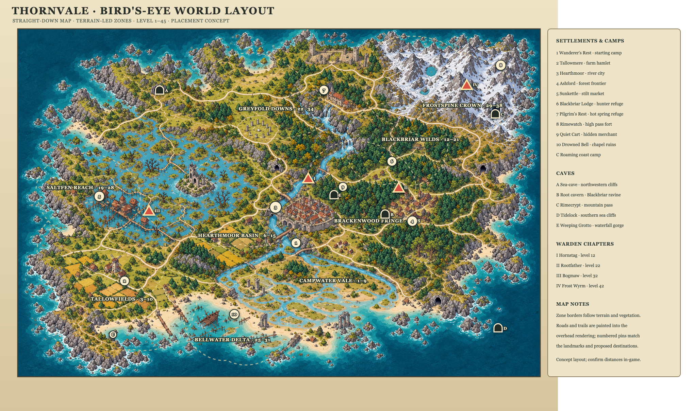
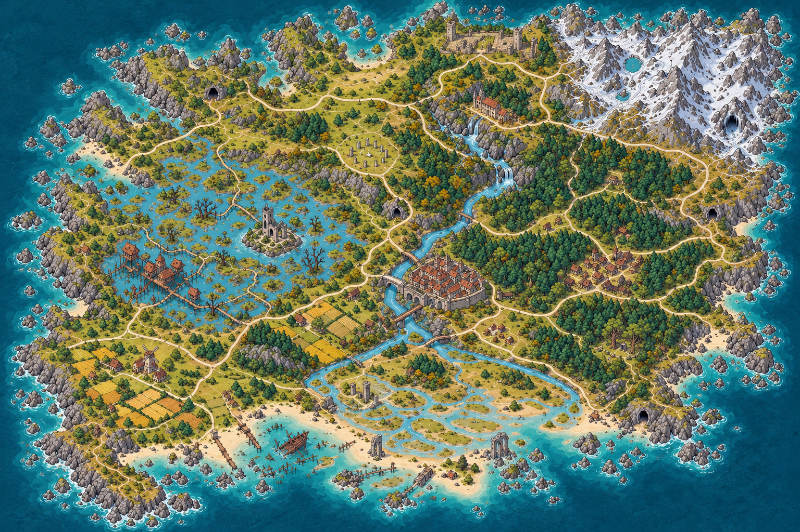
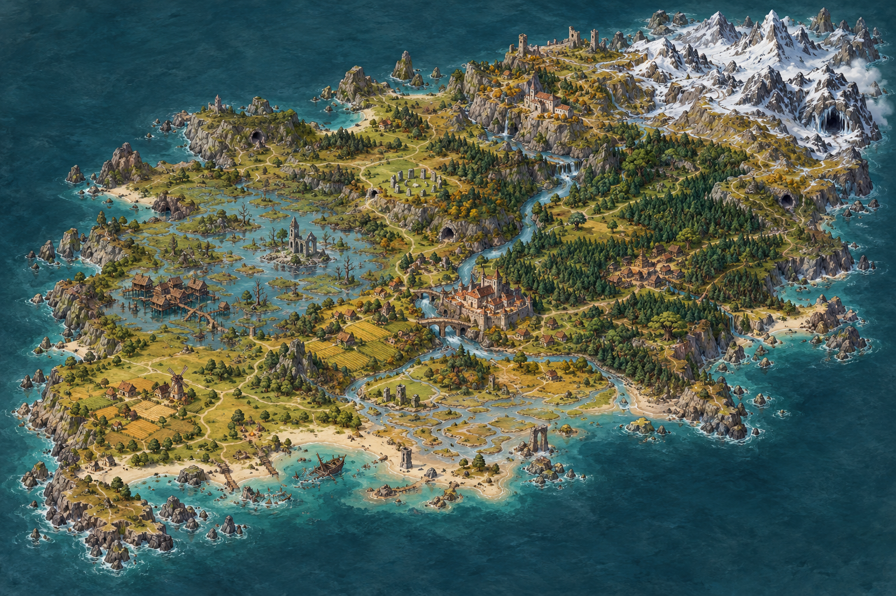

# Thornvale: Exploration Map and Level 45 Plan

**Status: built.** The 2.4 km island is now generated from the painted map (`assets/thornvale_world_topdown.png`): coast, rivers, fen and delta, roads, nine named zones, settlements, camps, landmarks, caves and Warden arenas. See "What is built" at the end for what is in the game and what is still open. Below is the original design direction, kept as the reference.

This was a design direction for the 2.4 km island. It keeps the progression bands from the previous draft and changes the land plan: more regional identities, stronger terrain landmarks, and a journey that begins at the current camp and unfolds through discovery.

For the current build-facing story, route, per-place level ranges, terrain-palette examples, and top-down zone schematics, see [WORLD_ZONE_STORY_ATLAS.md](WORLD_ZONE_STORY_ATLAS.md). That atlas is a proposed progression target; it does not describe the current generated zone boundaries or enemy tuning.

## Map-design direction

The earlier sketch read as four colored wedges with a town in the middle. This map should instead have a memorable outline and several different kinds of place within its broad climates. Give the island an inland river system, a wet western basin, a curved old-growth forest, a long northern ridge, and a ragged tidal coast. Let those landforms cause the local routes and settlement locations.

The inspiration is structural rather than a copy of another game's map: Hyrule is easy to read because its named regions have strong terrain identities; Blizzard describes Azure Span through elevation, coastal fog, and redwood character; Elden Ring's official overview calls out legacy dungeons that connect with the surrounding landscape. Thornvale can use those same broad principles at its own scale: a distinct silhouette per region, landmarks visible from more than one approach, and dungeons that feel rooted in the terrain around them. [Nintendo's Breath of the Wild overview](https://www.nintendo.com/us/store/products/the-legend-of-zelda-breath-of-the-wild-switch/), [Blizzard on Azure Span](https://news.blizzard.com/en-us/article/23823429/dragonflight-zone-preview-the-azure-span), [Bandai Namco on Elden Ring's landscape and legacy dungeons](https://en.bandainamco.eu/elden-ring/news/elden-ring-enter-the-lands-between-101-trailer)

## Exploration flow

Start at **Wanderer's Rest**, in the far south-west corner of the island, walking north-east into Tallowfields. Tam's camp is a quiet pocket; the tutorial road should quickly become an uncertain footpath. Let the player first wander toward Tallowfields, a ruin or cave, then discover the river crossing and Hearthmoor from an approach that does not feel like a direct spoke. Hearthmoor remains important, but players reach it as a discovery among other destinations.

Use a loose braided network rather than roads radiating from Hearthmoor: one old road that follows river terraces, an outer coastal track, forest trails, and a high pass, with bridges, ferries, gates, and shortcuts connecting them. Some paths should fade into deer trails. Place a striking landmark before a path junction so the player can orient by the land. Keep at least two routes into every broad region, while allowing caves and ruins to reward detours.

## Placement map and visual reference

The bird's-eye layout below is based on a direct overhead redraw of the high-resolution island reference. The newer pass corrects the earlier mismatch: zone borders now follow the terrain shown in that rendering, and numbered pins are placed on the visible settlement clusters, roads, cliff caves, forest ravine, and mountain entrances. Place names live in a side key to keep the image readable. The rendering is illustrative, not an in-game coordinate export; distances and exact pin locations still need to be checked against the playable world. Wanderer's Rest is the game start, in the bottom-left corner. The tents on the far southern coast are a roaming field camp.

[Editable vector version of the labeled placement map](assets/thornvale_world_expansion.svg)

### Bird's-eye terrain rendering

### Original high-resolution terrain and atmosphere reference

The original painting informed the overhead redraw's coast, wetlands, forest, river system, and mountain ridge. Use it as a mood reference; the new overhead rendering and annotated layout are the placement references.

## Distinct regions

These are named subregions, not a one-to-one mapping from Warden to biome. The biome systems can stay broad while terrain, vegetation, structures, lighting, enemy mixes, and local stories give each district its own identity.

| Region | Suggested levels | Visual identity and places |
|---|---:|---|
| **Campwater Vale** | 2–11 | Southern shore and river country: soft hills, pond, oak copses, small beaches, and fishing camps. Campwater Landing is a modest service settlement. |
| **Tallowfields / red Meadow** | 1–12 | Western lowland farms, hedgerows, orchard, windmill ridge, grazing commons. Wanderer's Rest and Tallowmere anchor the starting region; Hornstag is a working-name capstone at level 12. |
| **Hearthmoor Basin** | 6–15 | Central river crossing, open basin, old stone bridges, scattered shrines and the walled capital of Hearthmoor. It is one safe landmark in a connected world, not the source of every road. |
| **Brackenwood Fringe** | 9–18 | Dense, dark forest around Ashford; fern glades, leaning trees, watch platforms, forest-edge farms. Ashford's timber walls face into the woods. |
| **Blackbriar Wilds** | 12–22 | Older forest pocket with a ravine, root bridges, thorn thickets, hunter lodge, and Rootbound Ring. More enclosed and vertical than the fringe. |
| **Magenta Heath / Upland Scrub** | 19–28 | New distinct highland homeland north of Hearthmoor: cream/ochre heath ground is only a palette example; shared wells, grazing paths, village network, and a human community smaller than Hearthmoor. |
| **Cyan Wooded River Floodplain** | 23–31 | New distinct lowland zone: wooded banks, seasonal channels, ferry points, mills, and a river-junction market town. Different from both the peat fen and tidal delta. |
| **Saltfen Reach** | 21–31 | Broad western peat basin, reed channels, raised walkways, misty pools and Sunkettle's stilt market. Dry islands and wooded banks break up the wetlands. |
| **Bellwater Delta** | 27–34 | Where fen streams meet a tidal estuary: drowned chapel, bell tower, wrecks, mudflats and sluice ruins. The water Warden chapter is planned around level 32. |
| **Greyfold Downs / Northern Saddle** | 28–38 | Proposed smaller exposed saddle after the magenta split: pale grass, standing stones, ridges, old pilgrim markers, a roaming camp, and dangerous shortcuts. |
| **Frostspine Crown** | 30–45 | A long broken mountain ridge: pine foothills, slate cliffs, snowline, glacial notch and high alpine peaks. Pilgrim's Rest sits at a hot spring; Rimewatch clings to a pass. Continue guided quests to level 45 after the level-42 Warden chapter. |

## Main places and encounter anchors

- **Wanderer's Rest** is the only guaranteed starting point (south-west corner).
- **Tallowmere** introduces farm life and a family quest chain.
- **Hearthmoor** is the largest city and a place to revisit; it should not be the map's road hub.
- **Ashford** is a frontier village nested into Brackenwood's edge.
- **Sunkettle** is a compact stilt settlement in Saltfen Reach.
- **Pilgrim's Rest** and **Rimewatch** are refuge and fort, not generic villages.
- **Blackbriar Lodge**, a roaming hunter camp, the hidden **Quiet Cart**, and other small camps give trails mid-journey rest points.
- Keep the five current caves, but root their approaches in varied landforms: burrow in the farm bluffs, root cavern in old-growth, spider den in a dry wood hollow, Weeping Grotto below the fen, and Rimecrypt inside the glacial ridge.

### Settlement and zone-story direction

**Confirmed direction:** zones can contain several smaller settlements and one primary larger settlement. Scale that larger place to its region; it need not rival Hearthmoor. Build each zone's story around the people and livelihoods connected by this settlement network, rather than treating every location as a standalone quest hub. The player's marked-up map proposes three meadow regions in total by dividing existing grassland, without expanding the landmass or adding new terrain:

| Markup outline | Proposed role | Status |
|---|---|---|
| Red, south-west | Keep the current Meadow zone and its identity here. | Existing region footprint to retain/refine. |
| Cyan, south and central river country | A wooded river floodplain with seasonal channels, distinct from the existing peat fen and tidal delta. | New proposed zone; biome direction confirmed, name and story TBD. |
| Magenta, north of Hearthmoor and west of the ice | A second new zone of exposed heath and upland scrub: windswept open ground, hardy low shrubs, grasses, and scattered rock. This is the homeland of the distinct people and their larger settlement. They will be human or humanoid in overall appearance; any nonhuman traits should make sense for this zone and its way of life rather than being added only for novelty. | New proposed zone; terrain direction confirmed, people, name, and story TBD. |

Treat these outlines as the user's intended regional split; tune the exact in-game borders to terrain and routes when translating them into the world map. The red zone remains Meadow; the cyan and magenta regions should read as different biomes and cultures, not just renamed patches of grassland. The magenta zone is confirmed as the homeland for the distinct people and their larger settlement.

### Draft story baseline: magenta heath

**Status: first-pass direction discussed with the user; names and quest details remain open.** The heath's people are human and strongly community-minded. Their villages cooperate because their exposed upland depends on shared wells, springs, grazing paths, and safe travel. Give the zone one substantial town, smaller than Hearthmoor, that serves as a market and gathering place, plus several villages and trail refuges. A common hall or open assembly yard can make collective decision-making visible in play without turning every quest into a council meeting.

The local problem begins with the water: the shared springs are weakening, changing course, or behaving unevenly, and herds are being driven away from familiar routes by a dangerous creature. The player helps restore safe travel and supplies by gathering repair materials, defending herders, and following the water trail to old markers, a shrine, or a ruin. Some people want to reopen an old channel or expand quarrying and pasture to secure more water; others fear disturbing the places the markers warn them to leave alone.

Use the heath to foreshadow the water Warden, not host its main boss encounter. The springs are high in the watershed, so changes here can feed into the wooded floodplain and eventually the wetlands or delta downstream. Keep the major water Warden encounter in that downstream wetland/delta setting, where its scale and water behavior fit the landscape and where evidence from several regions can converge. This extends the current Bogmaw placement direction; its final identity and exact arena remain open.

Keep both explanations for the Warden's anger equally plausible. Fresh cuts, redirected water, and widened paths support human interference; residents also remember the springs and Ember-shrine lights faltering before the recent work began, supporting the failing Ember as another possibility. Clues and dialogue should leave the player with evidence to weigh, not a confirmed answer. The heath's resolution can restore a safe route and help the villages share water, while an environmental change—such as a spring returning in one place and weakening in another—keeps the consequences visible and unsettled.

The zone's story identity is cooperation under strain: people share labor and resources, but disagree over risk and whose village should receive scarce water first. This distinguishes them from Hearthmoor's civic scale and the cyan floodplain's river-linked trade network. Exact settlement names, the creature involved, the main quest beats, and the final zone boundary still need discussion.

Keep the four main Wardens as story bosses while placing them in a more varied map: Hornstag in a meadow/woodland border grove, Rootfather deep in Blackbriar's old growth, Bogmaw under the fen and delta waterways, Frost Wyrm above the snowline. Other regions still need their own elites, dungeons, quests, and gathering loops; the Warden is not a substitute for regional content.

## Story premise and delivery

**Core premise (confirmed direction):** the Wardens are defending natural forces that the Ember once kept in balance. They can be dangerous to people without being simple villains. Keep this as a mystery the player uncovers over the whole journey; the game should not explain the premise up front.

**Boss identity direction (confirmed):** rethink the Wardens as unique natural creatures that once served as protectors and have since become angered or hostile. Their behavior should make them dangerous in play, while traces of their old protective role remain discoverable. Keep human interference and the failing Ember evenly plausible causes of their change, without confirming either or ruling out another cause. Let physical evidence and dialogue support both explanations. Convey how much weight to give each spoken claim through its wording, certainty, and speaker; do not label dialogue as firsthand, secondhand, or gossip. "Warden" can remain the name people use for them without proving what they are.

Use a shared design pattern, not a shared creature shape: each boss should have a recognizable presence, a territory or natural process it affects, a reason its current behavior harms nearby people, and an encounter that shows a trace of protective behavior. Keep those details distinct across regions and let clues support more than one explanation.

The existing opening gives the player the visible problem: the Ember is dying, the Wardens have turned, and settlements need help. King Aldren and Elder Rowan call the player the Ember's Keeper and send them to the shrine, but the story should not immediately explain why the Wardens changed or why the player was named Keeper. Preserve those as questions that attentive players can investigate.

### Layered discovery

1. **The main path shows consequences.** Townsfolk describe dangerous creatures, disrupted travel, failing crops, strange weather, and blocked routes. Main quests give clear actions that fit the regular play loop: fight, gather, prepare, explore a ruin or cave, and confront a regional threat. Players can understand what to do without reading every note.
2. **Optional clues challenge the first explanation.** Use notes and letters, shrine inscriptions and carvings, ruins, item descriptions, and environmental details in caves, camps, settlements, and boss approaches. Mix brief fragments for quick discoveries with occasional fuller entries for players who choose to read more. These should feel like traces left in the world, not a separate lore system. A clue should suggest that a Warden's actions also protect or restore something, without stating the full answer on its own.
3. **Different people offer incomplete interpretations.** Farmers, hunters, pilgrims, town leaders, and scholars should explain events from what they have witnessed and what they fear. Their accounts may disagree; treat the disagreement as character perspective rather than a puzzle with a single exposition NPC.
4. **The player assembles the pattern.** Optional readers can connect evidence across the four Warden regions and infer what natural balance the Ember maintained. Do not require this collection to unlock levels, gear, dungeons, or the main boss path. Keep the journal useful as an archive of found evidence rather than an automatic explanation of every clue.
5. **Bosses and world changes provide payoff.** Show each Warden acting in line with the force it protects during the encounter and in the surrounding terrain. After a Warden is defeated, let the region visibly recover in one way and lose something in another, so victory feels consequential without declaring the Wardens evil or innocent.

Use concise, readable clues with a distinct voice and a concrete detail. The player who skips reading should still follow the immediate story and progression; the player who investigates should gain a much fuller, potentially unsettling interpretation. Avoid hiding essential instructions, combat understanding, or progression rewards inside lore text. Keep the exact natural force behind each Warden, the reason the Ember is failing, and the truth behind the Keeper title open until those pieces are designed together.

### Opening story trail: Wanderer's Rest to the Hornstag

**Purpose:** give the player an understandable first regional problem and a satisfying route into the first Warden encounter, while planting clues that can be dismissed or connected later. This is a proposed story structure; names and quest details can change to fit the implemented opening.

| Beat | Main-path experience | Optional evidence and interpretation |
|---|---|---|
| **1. Leave camp** | After the opening tutorial, Tam asks the player to take basic supplies to Tallowmere. The farm hamlet has lost contact with nearby holdings, and its grazing lane is unsafe. This gives the player a practical reason to travel and meet the first settlement. | A weathered trail marker near camp bears an antler symbol over an older, nearly erased water-line mark. It is easy to read as decoration. |
| **2. Help Tallowmere** | Residents need help recovering livestock, gathering repair materials, and making the road passable. The immediate threat is clear: large beasts have damaged fences and driven people indoors. These tasks teach gathering, combat, and selling or crafting without requiring lore reading. | A hunter says the Hornstag has ignored people on the old trail but charged anyone cutting trees or digging near the spring. A farmer disputes this and says it attacks at random. Neither is presented as fully reliable. |
| **3. Follow the damage** | The player follows tracks from the grazing commons toward a meadow-woodland grove. A short cave or ruin detour can provide a local resource and a small side story, but is not required to reach the Warden. | The tracks circle a spring and an old stone channel. The channel is blocked with roots and antlers; the spring-side plants are unusually green while nearby fields are dry. A scratched boundary stone warns against opening the channel, but gives no reason. |
| **4. Face the Hornstag** | The Hornstag attacks when the player enters its grove. The encounter presents it as dangerous and territorial, not as a speaking villain or a misunderstood friend. After the fight, Tallowmere's route and fields become safer. | During the encounter, it repeatedly turns toward the spring or blocks access to it. This can be read as protecting its territory, guarding a resource, or simply using favorable ground. The game does not explain which reading is correct. |
| **5. Return to a changed place** | Tallowmere celebrates the safer road and resumes farm work. The player receives ordinary progression rewards and is pointed toward the next destination. | The spring's level falls, or its water becomes cloudy, while the farms benefit from fewer attacks and more open land. A local blames the Warden's death; another says the spring was already failing. The journal records what the player saw without settling the cause. |

Keep the central clue pattern observable but inconclusive: the Hornstag's violence clusters around a spring and old waterworks; the settlement benefits from its defeat; the landscape also loses something afterward. A player who reads nothing still gets a complete first chapter. A player who investigates has a reason to question whether the Wardens' apparent aggression is the whole story, but no single clue proves a hidden truth.

## Draft story atlas by zone

**Status: broad structure for discussion, not locked canon.** Each zone should support the regular loop of exploring, fighting, gathering, crafting, trading, and preparing for tougher threats. Give each a primary settlement with smaller villages, camps, or work sites around it. A zone story should begin with a practical local need, reveal how the region's people depend on one another, and add one piece of the wider mystery. The red, cyan, and magenta outlines are treated as three distinct story zones below; their borders still need to be reconciled with the current region names, especially Campwater Vale and Greyfold Downs.

| Zone | Settlement structure and social identity | Local story pressure | Wider-story role |
|---|---|---|---|
| **Tallowfields / red Meadow** | Wanderer's Rest is the start camp; Tallowmere is the main farm hamlet, with farmsteads, an orchard, and a windmill nearby. The local ties are family, shared labor, and keeping the road to market open. | Crops and livestock are threatened by dangerous wildlife and failing water. Players help farms recover supplies and make lanes safe. | The first Warden chapter (Hornstag is a working name) begins at the meadow-woodland boundary. The area becomes safer after the fight, but a spring or grove visibly loses something, leaving doubt about what the creature had been protecting. |
| **Campwater Vale** | Fishing hamlets and shore camps serve small river and coast communities. A modest landing is the local service point, not a regional capital. | Fish runs and safe crossings become unreliable, forcing people to share catches, tools, and routes. This is a low-level introduction to gathering, cooking, and helping a settlement. | Early environmental oddities make the Ember's decline tangible before anyone can explain it. Keep its local problem legible without making this the source of every island crisis. |
| **Hearthmoor Basin** | Hearthmoor is the largest city, with nearby crossing camps, farms, bridges, and shrine sites. It is politically important but not the hub of every road or local story. | The city struggles to coordinate aid as roads fail and reports from outlying regions conflict. Leaders disagree about where limited supplies should go. | Main-quest meetings and returning-character moments happen here. The city offers theories about the Wardens, not a definitive explanation; optional records in its archives add context without solving the mystery. |
| **Wooded River Floodplain / cyan** | A market town at a river junction links smaller villages on raised banks, ferry points, mills, and woodland clearings. People depend on river trade and shared waterworks. | Channels shift, bridges and ferries become unreliable, and upstream/downstream communities dispute who should maintain or redirect water. Quests restore crossings and supplies while keeping the floodplain distinct from the peat fen and tidal delta. | It carries water and evidence downstream from the magenta heath. Conflicting physical signs can suggest both human alterations and the Ember's failure are affecting the river. |
| **Heath and Upland Scrub / magenta** | A human, community-minded people maintain a substantial town smaller than Hearthmoor, several villages, shared wells, grazing paths, and trail refuges. A common hall or gathering yard makes collective decision-making visible. | Shared springs weaken or change course, herds leave familiar paths, and villages disagree over reopening an old channel or expanding pasture and quarrying. Players repair routes, help herders, and investigate old markers or a shrine. | The heath is high in the watershed and foreshadows the water Warden. Its evidence supports human interference and the failing Ember equally; the main water-Warden encounter belongs downstream in the wetlands or delta, not here. |
| **Brackenwood Fringe** | Ashford is a timber-walled frontier village, supported by forest-edge farms, watch platforms, and isolated work camps. The people include settlers, woodcutters, scouts, and traders with different needs. | Patrols disappear and trails become unsafe as work pushes farther into the forest. The player helps reconnect outposts and learn which routes remain passable. | Clues show that the forest's danger is patterned around particular groves and old boundaries. Some residents blame expansion; others point to strange growth and failing Ember shrines. This leads toward Blackbriar without declaring either account correct. |
| **Blackbriar Wilds** | Blackbriar Lodge and small hunter refuges serve a sparse, experienced population. Root bridges and narrow paths make local knowledge important. | A ravine route and nearby settlements are being closed by roots, thorns, and aggressive creatures. The local story asks whether people can safely keep using the forest paths. | The Rootfather is a working name for the old-growth Warden. The encounter and its aftermath show protection and harm together: clearing a route helps travelers while changing the old forest's barriers and growth. |
| **Saltfen Reach** | Sunkettle is a compact stilt market connected to reed-side hamlets, fishing platforms, and dry islands. Trade depends on guides and water routes. | Channels become difficult to read, supplies go missing, and communities argue about whether to keep using old waterways. The player gathers local materials, handles threats, and reopens a safe route. | The region carries the water mystery from the floodplain toward the delta. Silt, roots, and water levels offer evidence, but no single source explains why the system is changing. |
| **Bellwater Delta** | Small shore and boat communities cluster around a drowned chapel, bell tower, wrecks, and sluice ruins; a working port or ferry town can serve as the main settlement if the existing layout supports it. | Tides and channels turn dangerous, stranding people and exposing old structures. The player explores the ruins and restores a safe crossing before confronting the region's larger threat. | The current Bogmaw name is a placeholder for the water Warden. Place the main water encounter here or at the fen-delta boundary, where upstream clues converge with downstream consequences. Defeating it should ease one danger while visibly changing the delta. |
| **Greyfold Downs** | If any of this region remains distinct after the magenta boundary is drawn, keep it as a sparse transition of exposed ridges, standing stones, a roaming camp, and pilgrim markers rather than another meadow homeland. | Weather and route conditions make shortcuts risky; a refuge or pass route needs supplies and repair. This supports contracts and exploration between larger chapters. | Use Greyfold as a place to compare clues collected across regions. Its markers may record different interpretations of the Wardens, but should not provide a master answer. Exact footprint may be reduced or renamed after the magenta split. |
| **Frostspine Crown** | Pilgrim's Rest is a hot-spring refuge and Rimewatch a pass fort, with isolated miners, guides, and shelters between them. Their settlements rely on one another to keep the high pass open. | A dangerous pass, out-of-season cold, and changing meltwater threaten travel and winter stores. The player gathers cold-weather supplies, secures routes, and investigates the high peaks. | The Frost Wyrm is a working name for the final Warden chapter. The highland encounter should leave uncertainty about whether the creature, human activity, or the failing Ember altered the mountain's cycle. The pass opens, but snow and meltwater patterns change. |

This atlas is an outline, not a commitment to add a boss or large city in every zone. Several regions can share a settlement network across a border. Before finalizing the map, resolve whether Campwater Vale remains separate from the cyan floodplain, and how much of Greyfold Downs is reclassified as the magenta heath. Then build each zone's main quest and optional reading trail from the structures above.

## Level 45 progression

The longer bands from the prior plan remain the target. Each region should support several levels of play through its quest chain, local crafting materials, cave, elite, and optional discoveries. Neighboring bands overlap so players can explore in their own order.

| Region arc | Regular creatures | Elites / dungeon guardians | Warden / chapter beat |
|---|---:|---:|---:|
| Campwater Vale / Tallowfields / Hearthmoor Basin | 1–9 | 8–11 | Hornstag 12 |
| Brackenwood / Blackbriar | 9–18 | 17–21 | Rootfather 22 |
| Saltfen / Bellwater | 19–28 | 27–31 | Bogmaw 32 |
| Greyfold / Frostspine | 22–38 | 37–41 | Frost Wyrm 42 |
| Deep Runs | 45 cap | Endgame | Hard-mode familiar dungeons plus new level-45 dungeons and encounters |

Raising the cap to 45 would require aligned updates to all skill caps, XP thresholds and rewards, unlocks, talent points, save migration, enemy levels/stats, and item tiers. The guided regional questline should carry most players to combat level 45; continue the main story and highland quest progression after the level-42 Warden. Deep Runs are optional max-level dungeons and encounters unlocked at level 45, not a leveling band. The current game code still caps at 30.

## Density and route goals

Give each broad zone one primary settlement scaled to its role, plus several smaller villages, camps, refuges, work sites, or discoveries. Keep the 5 existing caves as the foundation for hard modes, while adding new endgame dungeons; retain 4 Warden chapter encounters as working story anchors, 2–3 larger ruins, and 10–15 smaller discoveries as density targets. Have a meaningful location every 100–180 m along major paths, with optional finds 30–100 m off path. Break up sightlines with hills, forest walls, river bends and ridge shoulders, then use towers, smoke, waterfalls, ruins, or snow peaks to help players reorient. Travel should feel like exploring a country, not following quest spokes.

## What is built

**World generation.** Terrain, water, biomes, roads and zones are read from the painted map (`scripts/layout_map.gd`, generated `scripts/layout_data.gd`; the generator lives in `tools/layout/`). To move a pin, edit the `pins` table in `tools/layout/export.py` and rerun it. The world is 1200 x 1200 cells (2.4 km), Hearthmoor at the centre. Player start: Wanderer's Rest, south-west.

**Zone levels as built** (enemy level is cosmetic for now; enemy stats still follow biome):

| Zone | Levels | Settlement / anchors in game |
|---|---:|---|
| Campwater Vale | 3-10 | Campwater Landing (fishing hamlet, Net-mender Peg), Southshore Camp, Broken Towers, Tidegate Arch |
| Tallowfields | 1-8 | Wanderer's Rest (start), Tallowmere (farm hamlet with windmill), burrow cave |
| Hearthmoor Basin | 6-15 | Hearthmoor (walled capital), Crossing Camp |
| Brackenwood Fringe | 9-18 | Ashford (log-cabin frontier village) |
| Blackbriar Wilds | 12-21 | Blackbriar Lodge (hunter hamlet, Huntsman Corwin), Rootbound Ring, root cavern, spider den |
| Saltfen Reach | 19-28 | Sunkettle (stilt and reed huts), Weeping Grotto |
| Bellwater Delta | 10-18 | Bellwharf (wreck-shack wharf, Wharfmaster Dunn), Drowned Bell, Drowned Chapel |
| Greyfold Downs | 22-34 | Greyfold Steading (turf huts, Shepherd Ysolt), The Barrow cave, Greyfold Stones, Greyfold Keep, The Quiet Cart |
| Frostspine Crown | 29-38 | Pilgrim's Rest, Rimewatch, Rimecrypt |

Levels above 30 exist on the map but the game still caps at 30, so Greyfold and Frostspine are tuned for the planned cap of 45. Bellwater's range is low (10-18) because the delta lies close to the start.

**House styles per zone** (`scripts/town_kit.gd`; every one is walk-in except the granary and keeps the same door/interior system):

| Zone | Style | Houses |
|---|---|---|
| Campwater | `coast` (whitewash, slate-blue roof) | Fisher cottage with upturned boat and net rack, granary on staddle stones |
| Tallowfields, Hearthmoor | `meadow` (plaster, thatch) | Farmhouse with cart shed and hay-loft, cottage; Hearthmoor adds the two-storey inn and townhouse, general store, apothecary, hall-houses, farms |
| Brackenwood, Blackbriar | `thornwood` / `briar` (dark timber, moss roofs) | Log cabin with covered porch and log-ends; longhouse, watchtower |
| Saltfen | `mire` | Stilt hut over water, reed hut on a raised peat platform |
| Bellwater | `tidal` (grey-teal driftwood) | Wreck shack built from a ship's hull, mast and torn sail |
| Greyfold | `downs` (pale stone, turf) | Dry-stone turf hut with weighted roof and peat stack |
| Frostspine | `peaks` (slate and snow) | Stone-based chalet with timber upper floor and balcony, lodge |

## Hearthmoor as built

- **Layout:** a street grid, not rings. A wide main avenue runs through the plaza toward the Ashford gate, a cross avenue runs from the plaza to the keep, and smaller streets every 26 m run parallel. Buildings sit on lots facing the street, props are in the yards, lamps line the avenues. The dirt is painted into the terrain; the old radial roads from the other gates still cross it.
- **Buildings:** two-storey inn (bar, tables, four bedrooms upstairs), general store (Bramble), apothecary (Sorrel, a second shopkeeper with her own name and face on the same shop screen), hall-houses, townhouses, houses, a smithy yard, chapel, windmill, barn and two small farms. All are roomy and keep the doorway clear.
- **Life:** market stalls and carts on the plaza rim, benches, a well, and villagers: two farmers, a minstrel outside the inn, a peddler and town watch on the plaza, a smith's helper, the innkeeper behind the bar.
- **Cleanup:** everything inside the walls is meadow, no stream or bridge runs through the town, and bridges elsewhere take the shortest crossing and avoid camps.
- **Maps:** minimap and big map show shops, forge, inn, chapel, keep and quest markers; the player is a raindrop pointing the way they face.

## Still open

- **Next (agreed order):** smithy and chapel redo (still just scaled), then the same street-grid, roomy-buildings pass for Ashford, the hamlets, camps and Greyfold/Frostspine settlements, with a different shopkeeper or villager in each.
- Hamlet quest givers (Peg, Corwin, Dunn, Ysolt) each have two or three quests, but the hamlets have no ambient villagers yet.
- Enemy stats still follow the biome table; Greyfold has its own creatures, the Barrow-King elite and The Barrow cave, but their stats are first-pass.
- Bow and staff are on the weapon rack at Wanderer's Rest; Ranged and Magic still use the old class kits. Waiting on the Battle Mage / Demon Hunter ideas for the Ranged and Magic talent rework, and on the exact rule for the Rage hybrid (only when talent points are equal between Bulwark and Venom/Shadow).
- Delta roads are rough; the minimap is a square with ocean margins and should be cropped to the island.
- A long tutorial walk from the new start; check pacing against the 7-step tutorial.
- Cap 45 content (skills, XP curve, items) per the Level 45 section; the Deep Runs.
- Boats, extra islands and map pins for discoveries.
