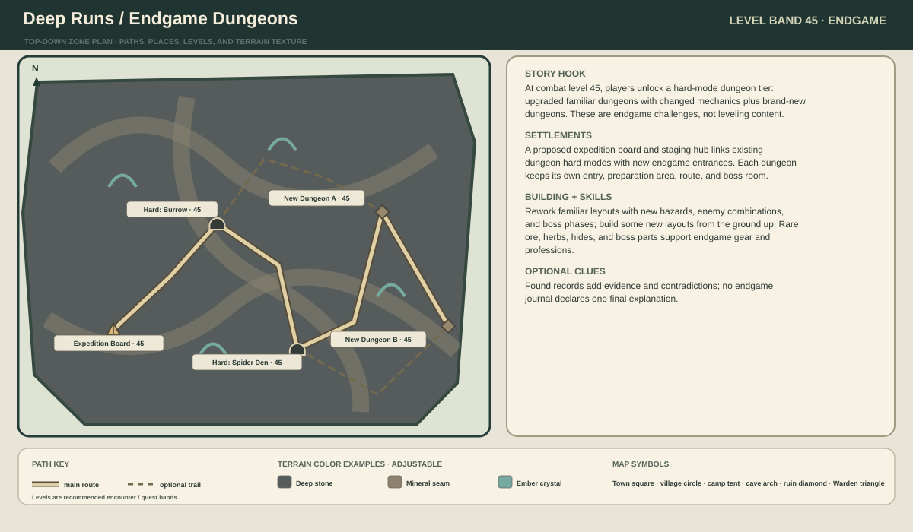
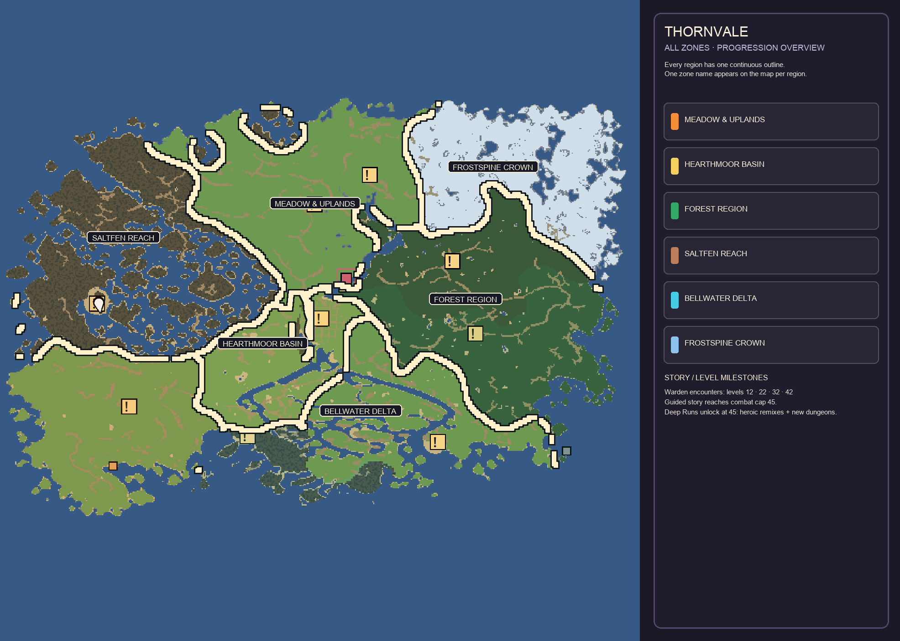

# Thornvale Zone Story and Layout Atlas

**Draft for discussion · cap 45 · top-down planning schematics**

This is a build-facing first pass for the zones: where people live, what a player does there, and which levels the encounters should support. The global region plan overlays the clean screenshot of the actual in-game map. Each region has one continuous outline and one name on the map; detailed roads, camps, dungeons, and story beats remain in the written notes so the map stays readable.

The marked map identifies the broad Meadow, heath, and river-country areas. The heath remains exposed upland scrub, home to a human, strongly community-minded people who share wells, grazing routes, and labor. Palette swatches in the drawings are examples for map readability, not final color choices.

**Updated region grouping:** Tallowfields, the Heath, and Greyfold Downs form one Meadow & Uplands region. Brackenwood Fringe and Blackbriar Wilds form one Forest Region. Campwater Vale, the wooded floodplain, and Bellwater Delta form one Bellwater Delta region, with early and late progression pockets inside it. Hearthmoor Basin, Saltfen Reach, and Frostspine Crown remain their own regions. The central rocky sliver immediately west of Hearthmoor's town grid is part of Hearthmoor Basin.

## Level route through the island

The main quest route moves forward through a small number of clear level bands. Adjacent areas overlap by a few levels so players can finish a side quest, explore a dungeon, or return to town without hitting a dead end. Campwater and Hearthmoor are side-loop / return locations, not mandatory detours that interrupt the northbound story.

| Journey beat | Suggested levels | Main route and purpose |
|---|---:|---|
| 1. Opening chapter | 1–12 | Wanderer's Rest → farm lanes → Tallowmere → Burrow Cave / old grove. Teach combat and the gather–craft–sell loop. The Hornstag encounter closes the opening at level 12. |
| 2. City and forest | 10–22 | Visit Hearthmoor for services and story leads, then follow Ashford's forest road into Blackbriar. Brackenwood (9–18) leads into the deeper Wilds (16–22), ending at the Rootbound Ring at level 22. |
| 3. Heath and headwaters | 22–28 | Cross into the Heath's shared-well villages and gathering town; follow the springs to their source. The upper trail toward Greyfold opens, while the main story follows water downhill. |
| 4. Downriver chapter | 27–32 | Follow the wooded floodplain (24–30) through Saltfen (24–31) to Bellwater Delta (29–34). Repair crossings, resolve local supply problems, and gather evidence that the changes affect multiple communities. Face the Water Warden at 32. |
| 5. Downs and final ascent | 32–42 | Return through Hearthmoor or use the Heath's upper trail to reach Greyfold (31–38), then climb into Frostspine (35–45). The Frost Warden at 42 closes the main Warden arc. |
| 6. Aftermath and cap | 42–45 | Revisit places changed by the journey, help communities adapt, and complete the guided story to reach combat level 45. Give these levels their own quest and encounter content rather than relying on grinding. |
| 7. Max-level endgame | 45 | Deep Runs unlock after the guided story reaches level 45: heroic versions of familiar dungeons and new endgame dungeons. They are not required to reach the cap. |

Campwater Vale (2–11) is an optional early shore loop that fits before or after Hearthmoor. Hearthmoor remains a return hub throughout the journey; returning there should not reset the story route or require choosing a new branch.

### Story and mystery pacing

The main quest should always give the player a concrete local reason to travel, while the deeper explanation stays optional and uncertain. NPC dialogue, notes, letters, shrine marks, and ruins can disagree or leave gaps; avoid labeling a clue as definitively true. A player who skips most reading should understand the communities' problems and why a Warden must be faced, while a careful reader can assemble competing explanations.

| Level / chapter | Story beat | What the player can reasonably infer |
|---|---|---|
| 1–11 · Meadow | Help farms and camps with dangerous wildlife, damaged routes, and a failing spring. Seed small oddities in markings and local observations. | The trouble is affecting ordinary life; its cause is not established. |
| 12 · Hornstag | The first Warden-like creature becomes the opening capstone. Resolve the immediate threat, then show traces that suggest it may once have guarded this place. | The creature is dangerous, but simple evil is not a satisfying explanation. |
| 13–21 · Forest approach | Missing patrols and blocked paths lead into old growth. Let different people read the same signs differently before the Rootbound Ring. | Something may be defending or reacting to change; the player cannot yet tell what started it. |
| 22 · Rootbound Ring | The second Warden encounter closes the forest chapter and opens the Heath route. Its aftermath makes travel safer but shifts an old boundary. | Defeating a Warden can help people and still disturb something else. |
| 19–31 · Heath, floodplain, and fen | Shared wells, failing channels, and disputed waterworks turn the mystery into a lived regional problem. Main quests follow the water downstream; optional records and shrine clues deepen the uncertainty. | The changes connect across places, but human work, natural shifts, and older forces remain plausible explanations. |
| 32 · Water Warden | Confront the danger in the delta after seeing its effects upstream. | The encounter explains the immediate threat, not the Warden's origin or the full cause of the imbalance. |
| 32–41 · Greyfold and Frostspine approach | High-pass records and changing snowmelt add incompatible accounts. Use the road, supplies, and settlements to motivate the final climb. | Old stories preserve fragments, not a trustworthy single history. |
| 42–45 · Final Warden and aftermath | Resolve the last major encounter at 42, then use the remaining levels for return journeys, repairs, and consequences that carry the player to 45. | The world responds to the player's actions, while the larger truth remains open to interpretation. |

### Proposed level ranges by zone

Ranges describe the recommended danger and quest level around each site, not a hard gate. Settlements can remain safe and useful after their nearby enemies become easy. Warden names are working names and the exact creatures are still open to redesign.

| Zone | Zone band | Main settlement | Chapter / capstone |
|---|---:|---|---|
| Meadow & Uplands | 1–38 overall | Tallowmere; Heath Gathering Town; Greyfold Steading | Meadow 1–12; Heath 19–28; Greyfold 31–38. Hornstag 12; headwater source 25–28; barrow / keep 34–38. |
| Hearthmoor Basin | 6–15 | Hearthmoor | First major service hub; city quests and river crossing, 12–15 |
| Brackenwood & Blackbriar forest region | 9–22 overall | Ashford; Blackbriar Lodge | Brackenwood 9–18; Blackbriar 16–22. Spider hollow 16–18; Rootbound Ring 22. |
| Bellwater Delta region | 2–34 overall | Campwater Landing; River Junction; Bellwharf | Campwater shore 2–11; wooded floodplain 24–30; delta 29–34. Sluice / shrine 29–31; Water Warden 32. |
| Saltfen Reach | 24–31 | Sunkettle | Weeping Grotto and fen elites, 26–30 |
| Frostspine Crown | 35–45 | Pilgrim's Rest; Rimewatch is the fort | Frost Warden 42; story and highland progression continue to 45 |
| Deep Runs | 45 cap | Expedition staging areas | Hard-mode familiar dungeons and new endgame dungeons |

**Progression rule:** the overall region range is not a promise that every subarea is appropriate at every level in that span. Follow the local subarea ranges above; early and late parts of a merged region intentionally serve different chapters.

## How to read the map

The global overlay uses the actual game map screenshot as its underlay. Orange groups Meadow, Heath, and Greyfold; green groups Brackenwood and Blackbriar; cyan groups the wooded floodplain and Bellwater delta. The orange subareas are geographically separated on this map, so they share a border color and one region identity rather than an artificial connecting border. Settlement labels show estimated local level bands. Smaller camps, ruins, caves, shrines, and routes remain in the written zone plans.

## Zone story plans

### 1. Meadow subarea: Tallowfields — levels 1–12

**Story and place plan.** Wanderer's Rest is a quiet tutorial camp. A hedged lane reaches outlying farms, then Tallowmere, the region's main farm hamlet. The windmill ridge and orchard are visible landmarks; the burrow cave and old boundary grove reward detours. Farmsteads cooperate to move grain, livestock, and repair materials to market, but work near an old spring has become dangerous.

**Route and encounters.** Camp track (1–3) → farm lanes (2–6) → Tallowmere (4–8) → windmill/orchard trails and Burrow Cave (6–9) → grove approach (9–11) → Hornstag encounter at 12. Make the grove a clear chapter capstone, with enough side loops to spend several levels in the zone before it.

**Built form and play loop.** Timber frames, plaster, thatch, fenced yards, cart sheds, haylofts, a granary, and a communal repair shed. Grain, hides, flax, herbs, and timber support cooking, tailoring, basic smithing, and selling extras. Optional spring markers suggest the Hornstag guarded something, but do not explain what or why it became hostile.

### 2. Campwater Vale — levels 2–11

**Story and place plan.** Soft southern hills meet ponds, oak copses, and broken shoreline. Campwater Landing is a modest fishing hamlet; Southshore is a seasonal camp, not a second town. Broken Towers and Tidegate Arch mark older shore routes.

**Route and encounters.** Southshore Camp (2–5) → pond and oak trails (3–6) → Campwater Landing (4–8) → Broken Towers (6–9) → Tidegate Arch (8–11). A shore loop links back toward Tallowfields and the lower river, so the player can discover these places in either order.

**Built form and play loop.** Whitewashed cottages with slate-blue roofs, net racks, upturned boats, smoke sheds, and a raised granary. Fishing, cooking, cordage, shell and shoreline gathering, and light gathering quests teach low-risk profession loops. A poor catch or unusual tide is a local hardship first and an early sign of wider imbalance only for attentive players.

### 3. Hearthmoor Basin — levels 6–15

**Story and place plan.** Hearthmoor is the island's largest city, set beside old bridges and a river crossing. Crossing Camp and nearby farms provide a smaller arrival point. Hearthmoor is a place to revisit, not a spoke hub: old river roads, ferry landings, and forest tracks pass through the basin on their own routes.

**Route and encounters.** Crossing Camp (5–9) → river road and bridge approaches (7–11) → Hearthmoor (safe services; quests 6–15) → shrine terrace and outer farms (10–15). Multiple exits lead toward the woods, upper meadow country, and southern waterways.

**Built form and play loop.** Walled gates, bridge stairs, jettied townhouses, market stalls, workshops, inn, apothecary, farms, and a civic hall. This is the first broad crafting and trading center. City leaders coordinate relief and ask the player to investigate reports, but their records and theories remain incomplete.

### 4. Forest region subarea: Brackenwood Fringe — levels 9–18

**Story and place plan.** Ashford is a timber-walled frontier village facing the dark forest. Forest-edge farms, watch platforms, and logging camps form a working boundary, not a clean line between civilization and wilderness.

**Route and encounters.** Hearthmoor's east road → timber camp (9–12) → Ashford (10–15) → two watch platforms (12–16) → fern ravine and spider hollow (15–18). A safe ridge trail bypasses the most enclosed woods and reconnects with Blackbriar's outer paths.

**Built form and play loop.** Dark timber, covered porches, mossed roofs, watchtowers, log yards, and clearings kept for farms. Timber, resin, mushrooms, and medicinal herbs support woodcraft, construction, and herblore. Missing patrols and blocked paths provide the local problem; boundary marks and conflicting explanations foreshadow the old-growth story without identifying a culprit.

### 5. Forest region subarea: Blackbriar Wilds — levels 16–22

**Story and place plan.** Blackbriar Lodge is a small hunter settlement at the edge of a ravine. Root bridges, thorn tunnels, and dense canopy make local guides valuable. A dry hollow leads to the spider den; the root cavern and Rootbound Ring lie deeper in the old growth.

**Route and encounters.** Lodge (12–17) → hunter's trail and ravine overlook (15–19) → root cavern / spider den (17–20) → root bridge route (19–21) → Rootbound Ring at level 22. A loop through the high ground allows a retreat or alternate approach before the capstone.

**Built form and play loop.** Longhouse, raised walkways, lookout platforms, lean-tos, and rope-and-root bridges. Hardwood, rare fungi, venom glands, and herbs feed smithing handles, poisons, and potions. The working-name Rootfather blocks travel and punishes cutting or digging; post-fight changes help travelers but alter the forest's old barriers too.

### 6. Heath subarea: Magenta Heath and Upland Scrub — levels 19–28

**Story and place plan.** This is a human homeland of closely connected villages and shared responsibility. One substantial town, smaller than Hearthmoor, hosts a gathering hall and market. Shared wells, grazing paths, trail refuges, and seasonal meetings connect the villages. The town and surrounding hamlets need names after the culture is clearer.

**Route and encounters.** Hearthmoor's northern track or Blackbriar's upper trail → ridge refuge (19–21) → outer well villages (20–23) → central gathering town (21–27) → cairn trail / old channel (24–26) → headwater springs and source shrine (25–28). The upper route reaches Greyfold's level-31+ content; the main story follows the water downhill into the floodplain.

**Local story.** Shared springs weaken or change course, herds leave familiar paths, and villages disagree over reopening a channel or expanding pasture and quarrying. The player repairs routes, helps herders, and investigates old markers. Human work provides a plausible cause, while accounts of springs and Ember-shrine lights failing earlier keep the Ember's decline plausible too. No Warden boss is placed here; this zone foreshadows the water Warden downstream.

**Built form and play loop.** Low stone-and-timber houses, windbreak walls, communal well yards, covered gathering spaces, shared storehouses, and small roadside shrines. Hardy herbs, wool, stone, and spring water support cooking, clothing, building, and potions. The main story tests how a cooperative society handles unequal need without turning it into a simple faction choice.

### 7. Wooded floodplain subarea — levels 24–30

**Story and place plan.** Seasonal channels run through willow groves and wooded banks. A market town at a river junction links smaller raised-bank villages, ferry points, mills, and work camps. The people are connected by trade and shared waterworks; this is distinct from the heath's well-centered communal life and from the peat fen.

**Route and encounters.** Heath headwater trail → upper ferry camp (23–26) → willowbank village (23–27) → junction market town (24–30) → mill ford and channel works (26–29) → old sluice shrine (29–31) → downstream road to Saltfen. A high bank path and a boat path create two ways through the same region.

**Local story and play loop.** Changing channels make crossings and mill work unreliable; upstream and downstream settlements disagree about who should maintain or redirect water. The player helps repair crossings and keep supplies moving. Willow, clay, reeds, freshwater fish, and river stone connect gathering to cooking, carpentry, pottery/building, and crafting. Carvings and current lines carry clues downstream, but do not establish why the water changed.

### 8. Saltfen Reach — levels 24–31

**Story and place plan.** Sunkettle is a compact stilt market on a dry island, linked by reed walkways to fishing platforms, peat hamlets, and wooded banks. It is the broad, enclosed peat region; open tidal mudflats belong to Bellwater instead.

**Route and encounters.** Raised causeway from the floodplain → dry-island camp (21–24) → Sunkettle (24–30) → reed channels and herb platforms (24–28) → Weeping Grotto (26–30) → tidal sluice path toward Bellwater (29–31). A longer wooded bank route provides a safer alternative during high water.

**Local story and play loop.** Guides disagree about which channels remain safe, while supplies disappear along flooded routes. The player maps and reopens a dependable passage and finds evidence that water levels have changed beyond ordinary seasonal flooding. Peat, reeds, bog herbs, fish, and salvage support herblore, food, fuel, and craft upgrades. No one explanation is proven.

### 9. Tidal delta subarea: Bellwater — levels 27–34

**Story and place plan.** Bellwharf is a working shore settlement built from driftwood and reclaimed hulls. The drowned chapel, bell tower, wreck beaches, and sluice ruins sit among shifting mudflats and tidal channels.

**Route and encounters.** Bellwharf (27–31) → wreck beach and tide pools (28–30) → outer sluice camp (29–31) → drowned chapel / bell tower (30–32) → delta channel arena at level 32 → returning ferry route. Low-tide paths create optional shortcuts; a raised causeway stays open for the main route.

**Local story and play loop.** Tides and channels strand people and expose structures that were underwater. The player restores a safe crossing, learns how upstream changes arrive here, and confronts the water Warden around level 32. Bogmaw is only a working name. Fish, salt, shells, wreck timber, and salvage support cooking, smithing, and trading. After the encounter, one route improves while part of the delta loses water or changes course, keeping the outcome morally uncertain.

### 10. Meadow & Uplands subarea: Greyfold Downs / Northern Saddle — levels 31–38

**Story and place plan.** Greyfold is the high, exposed downs subarea of the larger Meadow & Uplands region, narrowing into the ridge approach between the Heath and Frostspine. Greyfold Steading serves passersby; a roaming camp and small shelters support the route rather than creating another city.

**Route and encounters.** Heath high trail → Greyfold Steading (30–34) → standing-stone ridge (31–35) → Barrow cave (33–36) → Greyfold Keep (35–38) → Frostspine foothills. A wind-sheltered lower path is longer but avoids the exposed crest.

**Local story and play loop.** Weather makes the shortcuts dangerous, a refuge needs supplies, and an old pass route is partially buried. Contracts, mining, highland herbs, and the Barrow cave support players through levels 31–38. Standing stones carry incompatible accounts of the Wardens, inviting comparison without delivering an answer.

### 11. Frostspine Crown — levels 35–45

**Story and place plan.** Pine foothills rise through slate cliffs and snowline to a glacial notch and high peaks. Pilgrim's Rest is the main refuge around a hot spring; Rimewatch is the fortified pass outpost. Isolated shelters and miners' camps link them.

**Route and encounters.** The optional lower foothill trail (33–35) → Pilgrim's Rest (35–38) → slate path and miner camp (36–39) → Rimewatch (38–40) → Rimecrypt (40–41) → summit route and Frost Warden at level 42 → post-Warden story, highland contracts, and elite routes through level 45. A glacial shortcut is faster but riskier; the main pass allows the player to return for preparation.

**Local story and play loop.** Out-of-season cold and changing meltwater threaten winter stores and close the pass. The player gathers cold-weather materials, reopens a route, and follows clues to the final Warden chapter. Ore, mountain herbs, hot-spring water, and monster parts support high-tier smithing, potions, and food. The pass becomes safer after the fight, but snow and meltwater patterns change; the reason stays uncertain.

### 12. Deep Runs — optional endgame at level 45

**Structure.** This is an endgame dungeon tier, not another overworld biome or a leveling band. After reaching level 45, players can tackle heroic/hard versions of dungeons they know, with stronger encounters and changed mechanics, and enter brand-new dungeons built for endgame. Some existing caves can be upgraded into these versions; add new locations too, rather than relying only on remixes.

**Unlock and challenge path.** Deep Runs unlock at combat level 45. They do not supply levels needed to reach the cap. Offer a clear first hard-mode dungeon, then let players choose between upgraded familiar dungeons and new endgame dungeons. Difficulty can rise through encounter mechanics, enemy combinations, hazards, and optional challenge variants while character level remains capped at 45.

**Story and rewards.** Hard modes let players see familiar places changed by later events; new dungeons can reveal places never visited on the main route. Both can test coordinated builds, combat skill, crafting, food, and potions. Rewards support endgame gear and professions. Optional records add evidence to the mystery but never deliver an explicit final explanation.

## Actual game-map region overlay

This pass starts from the supplied clean, unmarked map capture (`actual_game_map_clean.png`) and draws continuous, high-contrast boundaries with light region tints. The map has one label per region. It groups Meadow, Heath, and Greyfold as Meadow & Uplands; Brackenwood and Blackbriar as Forest Region; and Campwater Vale, the floodplain, and Bellwater Delta as Bellwater Delta. The Hearthmoor-adjacent rocky sliver is assigned to Hearthmoor Basin. These proposed boundaries and level bands supersede the old territory mask and level values in the game data.

## Implementation notes

- All site levels are proposed encounter/quest bands. The existing generated map currently uses different zone boundaries and some different levels; treat this atlas as the progression target, not a claim about what is already implemented.
- Each zone should have multiple activities at its core band: main quest, side chain, resource loop, dungeon/elite, and optional exploration. Do not expect travel distance alone to occupy a level band.
- Keep the main route legible through landmarks and safe rest points, but preserve at least one alternative trail into broad regions. Shortcuts should be discoverable, not radiating from Hearthmoor.
- The four Warden chapter levels remain 12, 22, 32, and 42 as planning anchors. They close the opening Meadow, forest, river, and final highland chapters in order. Creature concepts and exact arenas remain open to story redesign.
- The clean in-game map is the placement reference for the six proposed regions. Internal progression pockets can have distinct encounter ranges without gaining separate names or borders on the world map.
- Palette swatches and ground textures are examples for separating biomes visually, not locked art direction. Keep each region readable through some combination of color, material, vegetation, water, lighting, and architecture.
- The guided questline and regional content should bring combat to level 45. Deep Runs unlock at the cap and include heroic/hard versions of familiar dungeons plus new endgame dungeons; they do not provide leveling to 45.
